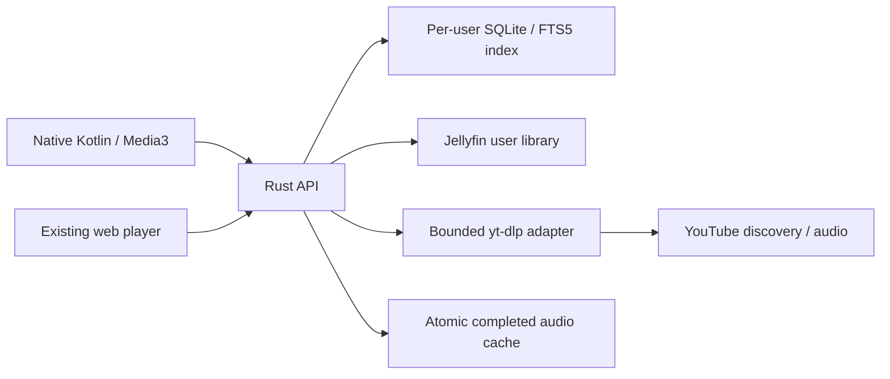

# Rust server and native Android architecture

## Data flow

Jellyfin remains the authority for files and library membership. Tuneflow stores
recording metadata per linked user, not a global administrator-visible catalog.
Library identity is `jellyfin:<item-id>` in the new responses. The compatibility
field `video_id` contains `jf_<item-id>` for Jellyfin and an ordinary eleven-character
ID for YouTube. New clients use `source` to distinguish providers. This compatibility
field keeps existing playlists and web player contracts usable during migration.

Jellyfin authentication is separate from Tuneflow login. Each user links an account;
there is no server-wide Jellyfin API key granting every household access to all music.
The link URL must match `JELLYFIN_URL` or one of `JELLYFIN_ALLOWED_URLS` exactly,
so users cannot direct the server to arbitrary network services. Existing links
remain stored after an upgrade, but playback and sync require their addresses to
be configured. Unlinking remains possible even if an address is no longer allowed.
Tokens are AES-GCM encrypted at rest. Changing JWT_SECRET invalidates existing JWTs
and makes stored Jellyfin tokens unreadable, requiring users to relink.

## API surface

The `/api/auth`, `/api/users`, `/api/households`, `/api/role-profiles`, `/api/parental`,
`/api/playlists`, `/api/history`, `/api/likes`, `/api/eq`, `/api/imports`, `/api/scrobbler`,
`/api/admin/cache`, and `/api/ai` compatibility routes are implemented in Rust.
Responses retain the fields consumed by the existing browser client. The new server
does not provide FastAPI's generated `/docs` or `/openapi.json` pages.

Additional endpoints:

| Method and path | Purpose |
| --- | --- |
| `GET /health` | Service/version health |
| `GET /api/jellyfin/status` | Link status, indexed track count, sync result |
| `POST /api/jellyfin/link` | Authenticate with `server_url`, `username`, `password` |
| `DELETE /api/jellyfin` | Unlink and remove that user's index |
| `POST /api/jellyfin/sync` | Queue a background scan; returns HTTP 202 |
| `GET /api/library/tracks` | Indexed tracks; `q`, `album_id`, `artist`, `limit`, `offset` |
| `GET /api/library/albums` | Indexed album groups with pagination |
| `GET /api/library/artists` | Indexed artists with pagination |
| `GET /api/music/search?q=...&source=library` | Fast, local default search |
| `GET /api/music/search?q=...&source=youtube` | Explicit, bounded external discovery |
| `POST /api/music/prepare` | Prepare up to two upcoming `video_ids` |
| `GET /api/admin/metrics` | Request/failure counts, resolver timing totals, cache counts |

All library and playback endpoints require an active Tuneflow account. Media URLs
may contain short-lived tokens scoped to a single track; these cannot call account
or library APIs. Native playback uses an authorization header instead. Upstream
Jellyfin tokens and signed YouTube CDN URLs are never returned in public stream info.

`POST /api/history` accepts an optional `session_id` with cumulative `listened_sec`.
Repeating updates for the same user/session updates the existing row monotonically.
This supports listening limits without duplicating recently played tracks or
scrobbling every progress update. Listening hours and daily limits use UTC, as in
the previous server implementation.

Catalog browsing remains optional and separate. MusicBrainz responses are cached
and requests are serialized to respect its request rate. Album opening first finds
recordings in the local library. YouTube matching happens only through explicit
album resolution; a weak or absent match stays unresolved. Discovery and imports
are not a promise that every catalog recording has an available external stream.

## Playback behavior

Android owns the playback queue in a Media3 service, independently of Activity
recreation. Its disk cache is partitioned by server and Tuneflow user, and stores
bytes during playback. ExoPlayer buffers one second before first playback, uses a
larger ongoing buffer, and preloads five seconds of the next queue item. Audio
focus, headset disconnection, notifications, and external transport controls use
Android's media APIs. No Rust/Kotlin interoperability layer is introduced.

Server audio caching is supplemental to client caching. Only full successful audio
transfers up to 128 MiB are persisted. Partial-range reads are forwarded directly;
a range that covers the whole file may also populate the cache. Cache disablement
still permits progressive playback. Retention and size policy are configured through
the existing cache administration API. Completed files are served with range support.

Jellyfin originals are currently streamed directly. Devices must support the source
codec. This implementation does not negotiate Jellyfin transcoding profiles or report
playback sessions back to Jellyfin. Tuneflow maintains its own listening history.

The YouTube extractor is a subprocess adapter, with separate audio/video lookups,
shared resolutions, deadlines, concurrency limits, and short error cooldowns. It can
be replaced or updated independently of the Rust server. Deno and the yt-dlp challenge
package are bundled by the deployment image. Production availability still depends
on upstream extraction requirements, network location, and track restrictions.

## Migration and operation

The startup migration adds server-side defaults to legacy SQLite tables. It writes
a full pre-migration backup, preserves IDs and data, and refuses unknown columns.
The Python and Rust servers must not write the same database concurrently. The old
source directories are retained for reference, not as runtime fallbacks.

The maintainer must configure JWT_SECRET before startup. TLS and network exposure
remain the deployment's responsibility. Application logs omit upstream media URLs
and request credentials. Metrics are administrator-only and are totals rather than
a full histogram/telemetry system.

On restart, interrupted import jobs from an earlier process must be resubmitted;
the import worker does not currently resume a partially read external playlist.
YouTube imports retain source IDs. Spotify imports match the local library and
preserve unmatched entries for review. The existing web interface does not gain
an automatic provider fallback or an invisible full-library YouTube scan.

## Verification limits

Local automated tests use synthetic media and mock provider responses. Device
playback is tested on an Android emulator. These checks do not establish throughput
or track availability on a particular household's live Jellyfin/YouTube setup.
The repository changes do not deploy to an existing server or connect to a user's
Jellyfin account without that user's credentials entered in Settings.
